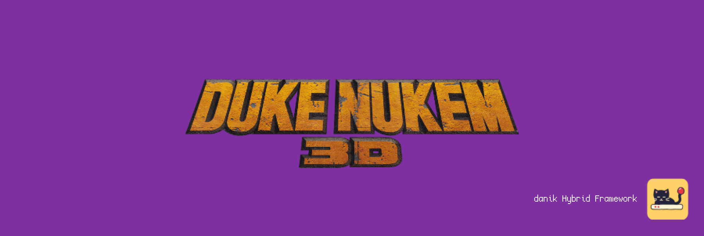
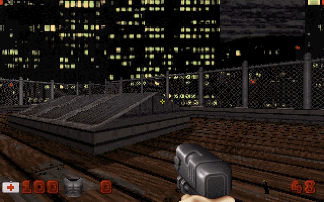

# EDuke32 for MiSTer

Duke Nukem 3D and its add-ons Duke It Out in D.C., Life's a Beach, Nuclear Winter, Duke!ZONE II and Penthouse Paradise on [MiSTer FPGA](https://github.com/MiSTer-devel/Main_MiSTer/wiki) as a hybrid port.

The game is [EDuke32](https://www.eduke32.com), the source port of 3D Realms' Duke Nukem 3D (1996) by Richard "TerminX" Gobeille, Evan "Hendricks266" Ramos and its contributors, on Ken Silverman's Build engine, with the engine's classic software renderer. It runs on the MiSTer's ARM CPU. The EDuke32 FPGA core provides native 15kHz video (CRT, VGA and HDMI) at 320x200, 640x200, 320x240 or 640x240, 44.1kHz audio, a MIDI synthesizer and an FM chip for the game's music, and keyboard, mouse and gamepad input with rumble. The two halves talk through shared DDR3 memory.

> **Beta.** Expect rough edges and please report problems in the issues.
>
> **Disclaimer:** AI is being extensively used to speed up development, but the project is well-maintained and supported.

  
  

## Requirements

- **danik_hybrid_ports**, the launcher: run it **once** from the MiSTer's `Scripts` menu ([The launcher](#the-launcher)). Without it the core says "Game not running".
- **Game data**, which is not included: `DUKE3D.GRP` of Duke Nukem 3D, version 1.3D or the Atomic Edition (1.4 or 1.5: from the original CD, *Megaton Edition* or the GOG release), or of the shareware version. The add-ons are optional and need the full game's `DUKE3D.GRP` as well: *Duke It Out in D.C.* (`DUKEDC.GRP`) and *Life's a Beach* (`VACATION.GRP`) of the same version as it (1.3D or Atomic), *Nuclear Winter* (`NWINTER.GRP`) with the Atomic Edition, *Duke!ZONE II* (`DUKEZONE2.GRP` of Raze's release, or the GRP of its CD) of the same version as it, *Penthouse Paradise* (`PENTHOUS.ZIP`, or the GRP of ZOOM Platform's release) with the Atomic Edition.
- **Recommended:** a gamepad with two analog sticks and analog triggers, like an Xbox or PlayStation controller. A gamepad without them works but is not recommended. The game can also be played with a keyboard and mouse.

## Installation

With `update_all` (Downloader 2.4 or newer, which update_all keeps up to date):

1. Copy [`downloader_danik_hybrid_ports.ini`](https://raw.githubusercontent.com/ItsDanik/Hybrid_MiSTer/main/launcher/downloader_danik_hybrid_ports.ini) to the root of your SD card (`/media/fat`).
2. Run `update_all`. That installs the launcher, **danik_hybrid_ports**, in `Scripts`.
3. Run **danik_hybrid_ports** from the `Scripts` menu, tick the games you want and press *X: Apply*. They are installed, and update_all keeps them up to date.
4. Copy **everything** in the game's folder (the one with `DUKE3D.GRP`) to `/media/fat/games/dnk/EDuke32/`, with its folders as they are, and leave nothing out (files the port does not use do no harm). The whole `gameroot` folder of *Megaton Edition* can be copied as it is. Each game is known by its file:

   | Game | Files |
   |---|---|
   | Duke Nukem 3D (1.3D, Atomic Edition or shareware) | `DUKE3D.GRP` |
   | Duke It Out in D.C. | `DUKEDC.GRP`, next to `DUKE3D.GRP` or in `addons/dc` |
   | Life's a Beach | `VACATION.GRP`, next to `DUKE3D.GRP` or in `addons/vacation` |
   | Nuclear Winter | `NWINTER.GRP`, next to `DUKE3D.GRP` or in `addons/nw` |
   | Duke!ZONE II | `DUKEZONE2.GRP` (Raze's release, with its `DUKEZONE2.GRPINFO`) or the GRP of its CD, next to `DUKE3D.GRP` |
   | Penthouse Paradise | `PENTHOUS.ZIP` as it is, not unpacked, or the GRP of ZOOM Platform's release, next to `DUKE3D.GRP` |
5. Load the game from the `Other` menu, e.g. **dnk-Duke Nukem 3D**, or from the `Hybrid Ports` folder if you moved the games there in the launcher.

> [!NOTE]
> The game data can go on a USB drive instead, into the same folder there (`/media/usb0/games/dnk/EDuke32/`): the game looks for it there first, and then keeps its settings and saved games there as well. Everything else stays on the SD card.

The game files are known by their contents, whatever their names. The menu entry of Duke Nukem 3D starts the shareware when the full game is not there. When a game's files are missing, the core says which files to copy where. Each game keeps its own OSD settings and button mappings. The core file itself (`_Other/dnk/dnk-EDuke32_*.rbf`, or from *Recent*) lists the games that are there to pick from; quitting a game then returns to the list. The game's log is in `/media/fat/logs/dnk/EDuke32/eduke32.log`. Settings (`eduke32.cfg`, `settings.cfg`) are in `/media/fat/games/dnk/EDuke32/`, as are the saved games of Duke Nukem 3D (`save0000.esv` and on); each add-on keeps its saved games in a folder of its own there, `DC`, `VACA`, `NW`, `DZ2` and `PP` (all of it on the USB drive, if the game data is there).

## The launcher

**danik_hybrid_ports** is what turns a menu entry into a running game. Once you've run it from the `Scripts` menu, it starts with the MiSTer, watches which core is loaded, and starts the game whenever a hybrid port's menu entry is loaded. It serves all our hybrid ports at once and updates itself through `update_all`.

Run it from the `Scripts` menu again whenever you want to change something. Its screen has:

- **Launcher**: on or off. Off, the ports' games no longer start (the core says "Game not running"), until you turn it on again.
- **Menu entries**: where the games appear in the MiSTer menu:
  - **Other, as dnk-\<Title\>**: each game in the `Other` menu, e.g. **dnk-Doom** (the default).
  - **Other/Hybrid Ports**: all of them in a *Hybrid Ports* folder in `Other`, without the `dnk-` in front.
  - **Main menu/Hybrid Ports**: a *Hybrid Ports* folder of its own in the main menu, next to `Arcade`, `Console` and `Other`.

  Moving them keeps each game's settings and button mappings. Favourites, recent lists and Zaparoo tags that point at the old place have to be made again.
- **The ports and their games**, a tickbox each. Tick what you want, untick what you don't.

*X: Apply* installs what is ticked and removes what is not, through Downloader, and moves the menu entries if you chose another place. When a port is removed, your game data, saved games and settings stay, and ticking it again brings it back as it was.

## OSD options

| Option | |
|---|---|
| Aspect ratio, Scale, Scandoubler Fx, Stereo Mix | as in other cores |
| FPS Counter | shows the pictures per second in the top left corner |
| HDMI Only | as in the other hybrid ports, for resolutions of 640x400 and more: EDuke32 has none, so nothing changes here |
| CRT Options | **Horizontal Size**: the picture's width **Horizontal Pos**: moves it left or right **Vertical Pos**: moves it up or down **HUD (Top)**: moves the messages, the level's name and the frag bar 0 to 24 lines off the top edge (default 0), at 240 lines **HUD (Bottom)**: lifts the status bar (or the mini HUD) and the weapon 0 to 24 lines off the bottom edge (default 0), at 240 lines  For a 15kHz screen: fits the picture to it and keeps the HUD out of the overscan. HDMI is not affected; not there with `forced_scandoubler=1` |
| Resolution | **320x200**: as the original (default) **640x200**: twice the detail across, same picture size **320x240**: the view fills the whole screen **640x240**: both  Always at 15kHz. With 240 lines the HUD is drawn over the view at the *HUD* margins; menus and pictures stay at 200 lines, centred. Applies at once; the game's own video mode menu is not there |
| L. Stick Sensitivity, R. Stick Sensitivity | how fast the left stick (walk, strafe) and the right stick (turn, look) move the player, 25% to 300%. They apply at once, on top of the sensitivity in the game's own menu |
| Limit Vertical Look | **On**: half of the game's range up and down (default) **Off**: the whole range  The Build engine shifts the picture instead of turning the camera, which distorts it the further you look up or down. For keys, mouse and gamepad alike |
| Rumble | **On**: as the game has it (default) **Strong**: twice as strong **Off**: none  When you take damage, fire, land hard or something blows up nearby; every controller that can rumble does |
| Music | **MIDI**: the core's synthesizer, or an MT32-pi when one is connected and on (default) **FM chip**: as an AdLib or Sound Blaster card played it  *SoundFont*: **Default** is GeneralUser GS, which comes with the port; 1 to 7 are your own `.sf2` files in `games/dnk/SoundFonts/`. A SoundFont that is missing, damaged or too big is said in the MiSTer's info box, and the music goes to the FM chip. Applies at once |
| MT32-pi | only there while an MT32-pi answers on the user port: see [NOTES.md](NOTES.md#music) |
| Cheats | **God Mode**: nothing hurts you **No Clipping**: walk through walls **Show Full Map**: the whole level on the map **No Monsters**: the monsters are gone **Give Everything**: every weapon with full ammo, armor, items and keys **Give Weapons**: every weapon with full ammo **Give Keys**: all keys **Next Level**: completes the level  As the game's own cheats, none of them at *Damn I'm Good*, nor in a demo or a user map |
| Save Diagnostic Report | the last line: see [If something is wrong](#if-something-is-wrong) |

## Controls

- **Keyboard and mouse:**

| Key | Action |
|---|---|
| W, S | Walk forward, back |
| A, D | Sidestep left, right |
| Mouse (or left, right) | Turn. Moving the mouse up and down looks up and down |
| Left mouse button (or right Ctrl) | Fire |
| E | Open, use |
| Space | Jump |
| Left Ctrl (C: on and off) | Crouch |
| Shift | Run (Caps Lock: always run) |
| 1 - 0 | Weapons |
| Mouse wheel, `'`, `;` | Next, previous weapon |
| Q | Quick kick |
| Enter, `[`, `]` | Use the inventory item, previous and next item |
| M, R, N, J, H | Medkit, steroids, night vision, jetpack, holoduke |
| Page Up, Page Down, Home, End | Look and aim up and down |
| Tab | Map |
| F6, F9 | Quick save, quick load |
| Esc | Menu |

- **Gamepad** (default mapping):

| Button | Action |
|---|---|
| Left stick | Walk and strafe |
| Right stick | Turn, look up and down |
| D-pad | Walk and turn |
| R (RB / R1), or R2 | Fire |
| B (Xbox A / PlayStation Cross) | Open, use |
| A (Xbox B / PlayStation Circle) | Jump |
| L (LB / L1) | Crouch |
| Y (Xbox X / PlayStation Square) | Next weapon |
| X (Xbox Y / PlayStation Triangle) | Use the inventory item. Held, with the d-pad left or right: the previous or next item (let go without the d-pad to use one) |
| L2, R3 (right stick click) | Quick kick |
| L3 (left stick click) | Run, on and off |
| Select | Map |
| Start | Menu |

Change the buttons in the OSD under *Define EDuke32 buttons*. *Menu OK* and *Menu Back* there are only needed for a spare button without a game function. While the OSD is open, the game gets no input.

> [!WARNING]
> A button left without a name in *Define EDuke32 buttons* does not reach the game at all, except L2/R2, L3/R3 and *Menu OK* / *Menu Back*. Name every button there, or leave the definition as it is. To go back to the default buttons, delete `config/inputs/EDuke32_*_input_*_v3.map` (each game has its own) on the SD card.

## If something is wrong

If the game stutters, the sound breaks up or something else is wrong, open the OSD while it happens and pick **Save Diagnostic Report**, the last line of the menu. The game keeps running; MiSTer's info box says the report is saved in `games/dnk/diagnostics/` on the SD card. Send that file (`EDuke32_<date>_<time>.zip`) with a few words on what went wrong.

The report has the setup (versions, the video and audio lines of `MiSTer.ini`, the OSD settings), how the last 60 seconds went, the game's log and a screenshot. Nothing else: no network settings, addresses, saved games or lists of your files.

## Building

How the port works, how to build it and notes for development: [NOTES.md](NOTES.md).

## Support

If you enjoy this project, you can support my work on [Patreon](https://www.patreon.com/itsdanik).

## Credits

- **[EDuke32](https://www.eduke32.com)** by Richard "TerminX" Gobeille, Evan "Hendricks266" Ramos and the EDuke32 contributors, which started from Jonathon Fowler's JFDuke3D.
- **Duke Nukem 3D** by 3D Realms Entertainment, who released its source code in 2003.
- **Build engine** by Ken Silverman.
- **Apogee Sound System** by James R. Dose, in EDuke32's audio library: its AdLib MIDI driver plays the music on the FM chip.
- **[JTOPL](https://github.com/jotego/jtopl)** by Jose Tejada (jotego): the FM chip in the core.
- **[GeneralUser GS](https://www.schristiancollins.com/generaluser.php)** by S. Christian Collins: the SoundFont of the core's MIDI synthesizer, which comes with the port, its licence next to it.
- **[SDL](https://libsdl.org)** by Sam Lantinga and contributors.
- **[MiSTer](https://github.com/MiSTer-devel)** by Sorgelig and the MiSTer-devel contributors: the framework and Template_MiSTer.
- **[MiSTer Frontier](https://github.com/MiSTerOrganize/MiSTer_Frontier)** by MiSTer Organize: thank you for the inspiration. Hybrid cores on the MiSTer, and the way their game is launched (a daemon that watches the loaded core and runs a script from its games folder), were inspired by MiSTer Frontier.

This project and its maintainers are in no way associated with or endorsed by 3D Realms, Gearbox Software or any other holder of rights in Duke Nukem 3D. It does not include any game data.

## License

The top-level scripts, tools and documentation are licensed under the [GPL-3.0](LICENSE). The components keep their own licenses: EDuke32 is GPL-2.0 (`eduke32/package/common/gpl-2.0.txt`) and the Build engine in it is under Ken Silverman's Build license (`eduke32/package/common/buildlic.txt`: free of charge, no commercial use), the libraries it brings under their own (in `eduke32/source/`); the part of the shared framework the game is linked with (`hybrid/hps/`) is GPL-2.0-or-later, the rest of `hybrid/` GPL-3.0 except where its files say otherwise; SDL and the SDL drivers in `hybrid/sdl2` are zlib, the FPGA core and the MiSTer framework are GPL-2.0 (`core/LICENSE`, with the core's own sources GPL-2.0-or-later), JTOPL in it is GPL-3.0 (`hybrid/rtl/jtopl/LICENSE`).
